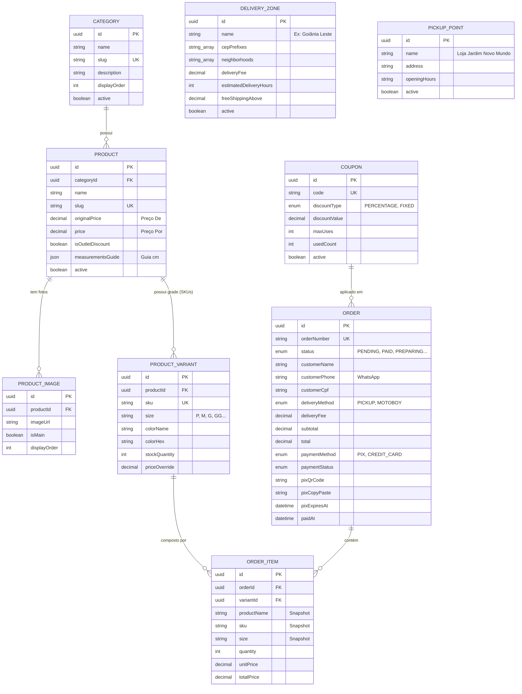

# Documentação Técnica e Modelagem de Dados
## E-commerce Lobos G Outlet (PostgreSQL + Prisma)

Este documento descreve a modelagem do banco de dados relacional e as regras técnicas que sustentam a operação sob medida da **Lobos G Outlet**.

---

### 1. Diagrama Entidade-Relacionamento (ERD)



---

### 2. Principais Decisões Arquiteturais

#### 2.1 Modelo de Grade de Roupas (Product $\rightarrow$ ProductVariant)
* **Produto Pai (`Product`):** Contém as informações visuais globais (nome, fotos gerais, descrição, tabela de medidas e categoria).
* **Variações Filhas (`ProductVariant`):** Cada combinação de tamanho (P, M, G, GG) e cor possui seu próprio registro com:
  * `sku` único (ex: `LOB-CAM-01-BLK-M`).
  * `stockQuantity` individual: permite controle rigoroso de estoque para evitar vender a mesma peça única para dois clientes do Instagram ao mesmo tempo.
  * O catálogo filtra produtos onde `stockQuantity > 0`, garantindo que o cliente só clique em itens prontos para despacho.

#### 2.2 Logística Regional Descomplicada (Sem Agregador de Frete)
Em vez de depender de APIs lentas dos Correios ou Melhor Envio, a consulta de frete ocorre em microssegundos:
1. **Retirada na Loja (`PICKUP`):**
   * Grátis. Utiliza os dados da tabela `pickup_points` (Endereço no Jardim Novo Mundo, Goiânia).
2. **Entrega via Motoboy (`MOTOBOY`):**
   * O sistema consulta a tabela `delivery_zones` comparando o CEP digitado com a lista `cepPrefixes` (ex: prefixos de Goiânia e Aparecida).
   * Se o valor do subtotal for maior que `freeShippingAbove`, a taxa é zerada na hora.
   * Se o CEP não for atendido, o checkout sugere retirada na loja ou redireciona para combinar entrega personalizada via WhatsApp.

#### 2.3 Resiliência e Histórico de Preços (Snapshotting)
* Na tabela `order_items`, armazenamos cópias congeladas (`productName`, `sku`, `size`, `unitPrice`).
* **Motivo:** Se o lojista alterar o preço da camiseta amanhã ou arquivar o produto, o histórico contábil e a visualização do pedido do cliente permanecem 100% fiéis ao que foi comprado.

#### 2.4 Fluxo de Pagamento via Pix Dinâmico
1. O backend gera o Pix via API da adquirente (Mercado Pago ou Asaas) com vencimento padrão de 20 minutos (`pixExpiresAt`).
2. Uma reserva temporária de estoque é aplicada durante esse período.
3. Quando o webhook recebe a notificação de confirmação bancária, o status muda para `PAID`, `paidAt` é preenchido e o disparo de WhatsApp é enfileirado para o cliente e para a equipe de separação.

---

### 3. Índices Criados para Alta Performance
Para assegurar tempos de resposta menores que 50ms nas consultas do catálogo mobile:
* `categories(slug)`: Busca veloz da página da categoria.
* `products(slug)` e `products(categoryId, active)`: Renderização instantânea da PDP e vitrine.
* `product_variants(productId, size)`: Agilidade na seleção de tamanhos.
* `orders(orderNumber)`, `orders(status)`, `orders(customerPhone)`: Busca ultra-rápida no painel administrativo e histórico de pedidos.

---

### 4. Como Executar o Schema com o Prisma
Quando o ambiente Node.js for configurado:
```bash
# Para gerar o Prisma Client tipado
npx prisma generate

# Para aplicar as migrações no banco PostgreSQL local ou na nuvem (Supabase/Neon)
npx prisma migrate dev --name init_lobos_ecommerce
```
